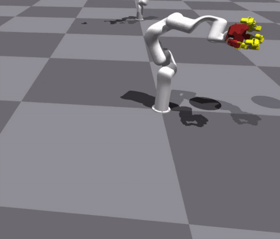
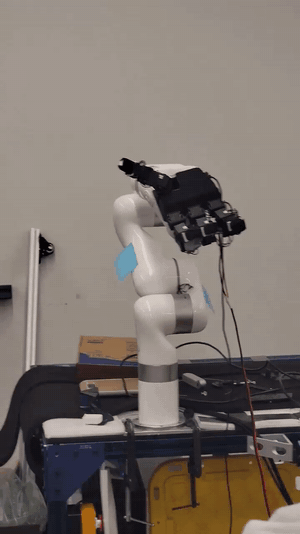
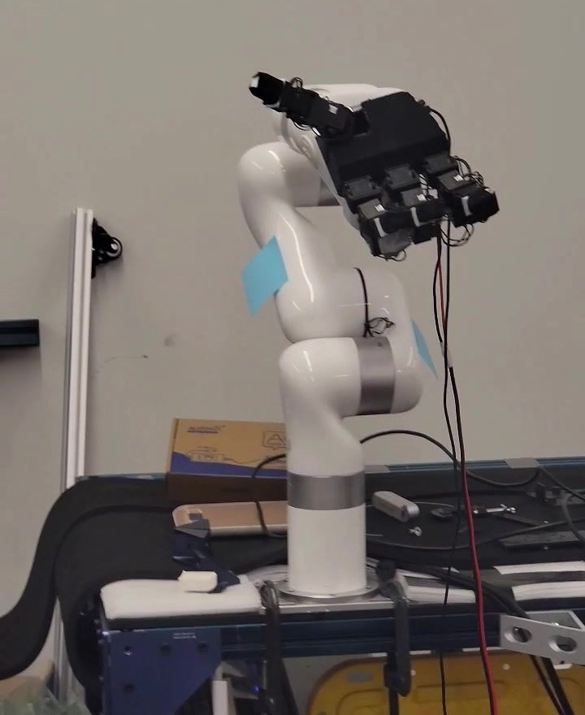

# Catching Everything Everywhere: Robot Arm

**Dynamic catching with an xArm6 + LEAP Hand.**

Sim-to-real reinforcement learning for catching thrown objects with a dexterous hand on a robot arm.
The policy is trained in Isaac Gym and runs on a real **UFactory xArm6** with a **LEAP Hand**, using an
Intel RealSense depth camera to track the incoming object.

This is the minimal release for **running a trained policy on the real robot**: the catching task (`Overhand`),
the policy runner, the robot model and the ROS nodes for the arm, hand and camera.

<p align="center"><b>Simulation:</b> the policy catching different thrown objects across parallel Isaac Gym environments<br>
<br>
<a href="media/sim_catch.mp4">media/sim_catch.mp4</a></p>

<p align="center"><b>Real robot:</b> xArm6 + LEAP hand catching a thrown plush<br>
<br>
<a href="media/real_catch.mp4">media/real_catch.mp4</a></p>

## Catching setup



| Part | Details |
|---|---|
| Arm | UFactory xArm6, Ethernet at `192.168.1.227` |
| Hand | LEAP Hand (16 Dynamixel motors over USB), driven by the LEAP Hand API ROS node |
| Camera | Intel RealSense depth camera (pose calibrated in `sim2real/camera_utils.py`, `view`) |
| Compute | Ubuntu + ROS 1 (Noetic), one NVIDIA GPU for Isaac Gym |
| Control | Policy runs at 60 Hz (sim dt 1/60). Object tracking at 30 Hz. All I/O over ROS |

The LEAP hand is mounted on the xArm6 flange (model: `assets/urdf/leap_hand_xarm6_v4/export/robot_v5.urdf`).
The camera watches the throwing area. Each depth frame is background-filtered to find the thrown object,
which is published to the policy as a relative position (`/cam/obs_dxdydz`).

<br clear="right">

## Repository layout

```
isaacgymenvs/
  train.py                 policy runner (train / test / real)
  tasks/overhand.py        catching task; with real=True it reads and commands the robot over ROS
  hardware_controller.py   LEAP hand ROS client used by the task
  depth_backbone.py        depth encoder for the vision policy
  cfg/                     Hydra configs: config.yaml, task/Overhand.yaml, train/OverhandPPO.yaml
  joints/eigengrasps/      hand eigengrasp basis used by the action space
sim2real/
  joint_control.py         xArm6 ROS node: /arm/joint_angles -> robot, publishes /arm/obs_joint_angles
  camera_depth.py          RealSense node: depth filtering + object tracking -> /cam/obs_dxdydz, /cam/ep_time
  camera_utils.py, depth_utils.py   camera intrinsics/extrinsics and depth filtering
assets/                    robot URDF + meshes, ball object set
rl_games/                  vendored RL library
scripts/run_real.sh        launch a trained policy on the real robot
```

## Install

Requires Python 3.8, a CUDA GPU, [Isaac Gym Preview 4](https://developer.nvidia.com/isaac-gym) and ROS 1.

```bash
conda create -n catch python=3.8 && conda activate catch
# Isaac Gym (downloaded separately from NVIDIA)
cd /path/to/isaacgym/python && pip install -e . && cd -

pip install -e .
pip install -e rl_games
pip install -r requirements.txt
pip install urdfpy pynput trimesh opencv-python pyrealsense2 xarm-python-sdk
pip install "git+https://github.com/facebookresearch/pytorch3d.git"
pip install "git+https://github.com/wrc042/TorchSDF.git"        # may need IGNORE_TORCH_VER=1
```

For the hand, set up the ROS node from the [LEAP Hand API](https://github.com/leap-hand/LEAP_Hand_API) (`ros_module`).
The task commands the hand on `/leaphand_node/cmd_ones` and reads it through the `/leap_position` and `/leap_effort` services.

## Run on the real robot

1. **Policy.** Copy a training run into `isaacgymenvs/runs/<RUN_NAME>/`, containing `Overhand.yaml`
   (the run's task config) and `nn/CatchXArm.pth` (weights; training saves under this name).
   No trained checkpoint is included in this repo.
2. **Hardware nodes.** Each in its own terminal, with ROS sourced:
   ```bash
   roscore
   # LEAP hand: start the LEAP Hand API ROS node (leaphand_node)
   python sim2real/joint_control.py                     # xArm6
   cd sim2real && python camera_depth.py --publish      # RealSense object tracking
   ```
3. **Policy.**
   ```bash
   RUN_NAME=<RUN_NAME> ./scripts/run_real.sh
   ```
   Isaac Gym opens one environment that mirrors the real robot, so you can watch the policy's view. Set `HEADLESS=True` to run without the viewer.

**Before the first run:** set the xArm IP in `sim2real/joint_control.py` and `isaacgymenvs/tasks/overhand.py`,
re-calibrate the camera pose (`view` in `sim2real/camera_utils.py`) for your mounting, and set the hand's
serial port in the LEAP Hand API node.
Keep the e-stop in reach. The policy moves fast.

## Notes

- Training code, other tasks and experiment branches are not part of this release.
  `task=Overhand` with `+real=False` still runs the policy in simulation for checking a checkpoint.
- Built on [IsaacGymEnvs](https://github.com/isaac-sim/IsaacGymEnvs) and [rl_games](https://github.com/Denys88/rl_games).
  This repo is MIT (`LICENSE`). IsaacGymEnvs-derived files keep their BSD-3 notice (`LICENSE-ISAACGYMENVS`),
  rl_games is MIT (`rl_games/LICENSE`), and asset licenses are in `assets/licenses/`.
